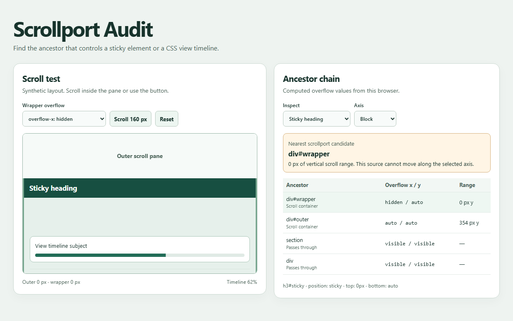

# Scrollport Audit

Find the ancestor that steals sticky positioning or a CSS view timeline. The audit shows computed overflow on both axes, the nearest scrollport candidate, and how far that source can scroll.

[](https://github.com/4onv/scrollport-audit/actions/workflows/ci.yml)

## Try the layout

Download `scrollport-audit.html` and open it locally. In the synthetic layout, press **Scroll 160 px** with `overflow-x: hidden` selected. The heading scrolls out of the pane. Switch the wrapper to `overflow: clip` and try again. The heading sticks to the outer pane. The report shows why each time. [Release files and checksums](https://github.com/4onv/scrollport-audit/releases/tag/v0.1.0)



## Inspect a real page

1. Download `scrollport-audit.js` from the release and review it. Run it as a DevTools snippet on the page you want to inspect.
2. Select the sticky element or the **subject** of the view timeline in the Elements inspector.
3. Run this in the console.

```js
const audit = ScrollportAudit.audit($0, { axis: 'block' });
console.log(audit.source, audit.warnings);
console.table(audit.ancestors);
```

The script adds `ScrollportAudit` to the page's JavaScript context. Running the audit reads layout and computed CSS without changing styles, moving scroll positions, or sending data. You can also import `auditScrollport` from the ES module in the release tarball.

### Read the result

- `source` is the nearest candidate in the DOM ancestor chain. A wrapper can own the scrollport even when it has no overflow to scroll.
- `overflow` shows computed x and y values. Setting `overflow-x: hidden` can make the initial `overflow-y: visible` compute to `auto`.
- `range` is the difference between scroll size and client size on the chosen axis, in CSS pixels. Logical `block` and `inline` use the candidate's writing mode. Pass `x` or `y` to inspect a physical axis.
- `warnings` highlights zero range, hidden overflow that requires programmatic scrolling on that axis, and sticky elements with both insets set to `auto`.
- The viewport row identifies whether its overflow came from `html` or the propagated `body` values.

When a wrapper only clips decoration, try `overflow: clip` in DevTools and compare the result. An intentional nested scroller should retain its scrolling behavior. [CSS Overflow](https://www.w3.org/TR/css-overflow-3/) · [CSS Positioned Layout](https://www.w3.org/TR/css-position-3/) · [Scroll-driven Animations](https://www.w3.org/TR/scroll-animations-1/)

## Scope

The audit models ordinary light-DOM HTML ancestry in standards mode. Its source is a diagnostic candidate. Specialized layout rules involving shadow roots, SVG, table boxes, out-of-flow descendants, containment, and clipping can require a closer browser inspection. It does not resolve a named timeline from an animation element, guarantee that a sticky element will stick, or measure every cause of an inactive animation.

The demo enables the animation where CSS view timelines are available and respects reduced motion. Playwright verifies sticky geometry and the view-timeline demo in Chromium, Firefox, and WebKit. Timeline-capable engines must show scroll-driven progress, while other engines must show the unavailable state. Safari on Apple devices remains a separate verification target. [Playwright browser coverage](https://playwright.dev/docs/browsers#webkit) · [November 14 research and idea comparison](docs/research-2026-11-14.md)

## Build and test

```sh
npm ci --ignore-scripts
npm run build
npx playwright install chromium firefox webkit
npm test
```

The build produces the standalone HTML demo and the DevTools snippet in `dist/`. MIT licensed.
